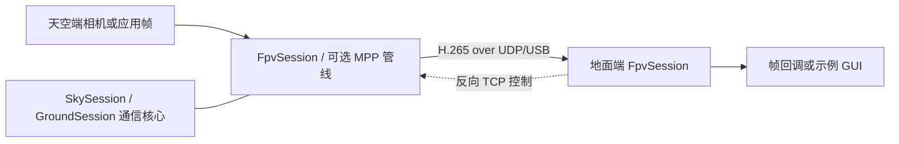

# FPV 图传 SDK

天空端（机器人）与地面端之间传输 H.265 视频，支持 UDP/USB 视频链路和独立 TCP 控制链路。原生双端示例位于 `example/`。

## 架构



- **通信核心**：`SkySession` / `GroundSession` 负责已编码帧的收发，不依赖 MPP。
- **管线门面**：可选 `FpvSession`，负责原始帧提交及 MPP 编码/解码。
- **控制平面**：`ControlSession` 使用独立 TCP 连接，通常由地面端发起请求。

### 公共头文件与 CMake 接入

使用安装后的 SDK 时，通过公开头文件路径包含接口，不要用相对源码路径：

```cpp
#include <video_transmission/session.hpp>     // SkySession / GroundSession
#include <video_transmission/config.hpp>      // 配置加载与校验
#include <video_transmission/control.hpp>     // TCP 控制
#include <video_transmission/fpv_session.hpp> // FpvSession，仅 pipeline 组件提供
#include <video_transmission/mpp_frame.hpp>   // MPP 帧，仅 pipeline 组件提供
```

只使用通信核心：

```cmake
find_package(video_transmission CONFIG REQUIRED)
target_link_libraries(my_app PRIVATE video_transmission::video_transmission)
```

使用 `FpvSession` / MPP 管线：

```cmake
find_package(video_transmission CONFIG REQUIRED COMPONENTS pipeline)
target_link_libraries(my_app PRIVATE video_transmission::fpv_pipeline)
```

链接导出的 CMake target 会自动提供头文件搜索路径和依赖。核心组件安装时不包含 `fpv_session.hpp`、`mpp_frame.hpp`、`mjpeg_decoder.hpp`；这些头文件随 pipeline 组件安装。

## 双端示例运行

示例依赖目标板上的 MPP、相机运行库和对应驱动。两端分别在同一 SDK 版本构建，并使用各自的配置文件。

### 1. 配置网络与设备

编辑：

- `example/config/sky.yaml`
- `example/config/ground.yaml`
- `example/config/connections.yaml`
- 两端配置引用的 deployment profile

填写实际的本机地址、对端地址、网络接口、传输方式和相机设备节点。两端视频端口和连接配置须匹配；多网卡时确认路由走图传接口。

### 2. 构建

在天空端和地面端各自的 SDK 根目录执行：

```bash
source build/envsetup.sh
lunch <包含图传 pipeline 与示例的目标>
m
```

若只改组件或示例，可在 SDK 环境中分别进入 `components/video_transmission` 或 `components/video_transmission/example` 执行 `mm`；依赖未构建时使用 `mm --with-deps`。

### 3. 启动

先在地面端启动接收程序，再在天空端启动发送程序。以下命令均从 SDK 根目录执行。

地面端：

```bash
source build/envsetup.sh
export MPP_PLUGIN_DIR="$PWD/output/staging/lib"
fpv_ground --config components/video_transmission/example/config/ground.yaml --gui
```

无本地图形桌面时去掉 `--gui`，程序仍可接收和解码。

天空端：

```bash
source build/envsetup.sh
export MPP_PLUGIN_DIR="$PWD/output/staging/lib"
fpv_sky --config components/video_transmission/example/config/sky.yaml
```

检查日志：天空端应持续采集并提交帧；地面端的编码接收和解码帧计数应持续增长。若没有帧，先核对配置、接口路由和模组链路，再检查相机设备及 MPP 运行库。

## 应用接入要点

- `SkySession` / `GroundSession` 处理完整 H.265 access unit；使用 `FpvSession` 的 raw 模式时提交线性 NV12 或 BGRA MPP 帧。一个会话不能混用 raw 与 encoded 输入。
- 帧数据和 `MppFrame.owner` 是借用资源；必须保证底层内存在 SDK 异步消费完成前有效。
- 在 `Start()` 前注册回调。生命周期操作由应用控制线程串行执行；回调运行于 SDK dispatch 线程，应快速返回，避免阻塞或在回调中停止/更新会话。
- `LoadConfig(path)` 加载并校验 SDK 配置；示例相机字段由 `example::LoadExampleConfig` 解析，SDK 不会因加载配置而自动打开相机。

更多示例参数和显示说明见 [example/README.md](example/README.md)；延迟测量与 ROS 2 迁移说明见 `example/docs/`。
