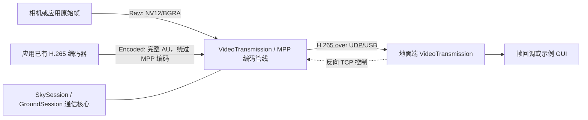

# 通用视频传输 SDK

天空端（机器人）与地面端之间传输 H.265 视频，支持 UDP/USB 视频链路和独立 TCP 控制链路。原生双端示例位于 `example/`。

## 架构



- **通信核心**：`SkySession` / `GroundSession` 负责已编码帧的收发，不依赖 MPP。
- **管线门面**：可选 `VideoTransmission`；Raw 输入由 MPP 编码，Encoded 输入直接发送已有 H.265 AU，地面端可选 MPP 解码。每个会话只使用一种输入模式。
- **控制平面**：`ControlSession` 使用独立 TCP 连接，通常由地面端发起请求。

### 公共头文件与 CMake 接入

统一使用安装后的公共入口头文件；链接 pipeline target 时会自动启用 MPP 管线 API：

```cpp
#include <video_transmission/video_transmission.hpp> // 完整 SDK，需链接 video_transmission::pipeline
```

该头文件是模块唯一安装的公共头文件。它始终提供通信核心、配置、控制、版本/延迟 API；链接 `video_transmission::pipeline` 时还会启用 `VideoTransmission`、MPP 帧与 MJPEG 解码 API。函数实现仍由对应库提供，包含头文件不能替代链接库。纯通信核心只需链接 `video_transmission::video_transmission`，无需 MPP。

只使用通信核心：

```cmake
find_package(video_transmission CONFIG REQUIRED)
target_link_libraries(my_app PRIVATE video_transmission::video_transmission)
```

使用 `VideoTransmission` / MPP 管线：

```cmake
find_package(video_transmission CONFIG REQUIRED COMPONENTS pipeline)
target_link_libraries(my_app PRIVATE video_transmission::pipeline)
```

链接导出的 CMake target 会自动提供头文件搜索路径和依赖。内部声明头文件位于 `src/video_transmission/`，不作为 SDK 安装接口。公共入口头文件由核心组件安装；MPP 类型仅在 pipeline target 的使用方启用。

### 公共头文件中的关键 API

公共 API 均通过 `video_transmission.hpp` 提供。最常用的门面是 `VideoTransmission`：用
`LoadConfig(path)` 读取配置，按 `input_mode` 选择一种输入，然后注册回调、`Start`、逐帧提交，
最后在应用控制线程调用 `Stop`。一个会话只能选择 `Raw` 或 `Encoded`，不能混合提交。

| API | 用途 |
| --- | --- |
| `LoadConfig` / `ValidateConfig` / `DescribeConfig` | 读取、校验和打印 SDK 会话配置。 |
| `VideoTransmission::OnState` / `OnEncodedFrame` / `OnVideoFrame` | 注册状态、收到的 H.265 帧或解码后 MPP 帧回调；在 `Start` 前调用。地面端按 `decoded_output` 选择解码帧或编码帧输出。 |
| `VideoTransmission::Start` / `Stop` | 启动和停止会话；生命周期操作由应用线程串行执行。 |
| `VideoTransmission::SubmitEncodedFrame` | 天空端 `input_mode: encoded`：直接提交完整 H.265 access unit，绕过 MPP 编码器。适用于应用已有编码器的场景。 |
| `VideoTransmission::SubmitFrame` | 天空端 `input_mode: raw`：提交合法的线性 NV12 或 BGRA `MppFrame`，由 MPP 编码。 |
| `AdoptMppFrame` / `ValidateMppFrame` | 将真实 MPP 帧及释放回调包装为租约，并在提交前检查帧布局；不负责分配、导入或像素转换。 |
| `MjpegDecoder::Decode` | 显式把本进程 MPP VB 中的单平面 MJPEG 帧转为 NV12，再送入 `SubmitFrame`。 |
| `SkySession::SubmitEncodedFrame` / `GroundSession::OnEncodedFrame` | 只用通信核心时，天空端发送、地面端接收已编码 H.265，不创建 MPP 编解码资源。 |
| `ControlSession::SendControl` / `VideoTransmission::SendControl` | 通过独立 TCP 控制链路发送控制消息；天空端用 `OnCameraControl` 注册处理器。 |

直接发送已有编码帧的最小形式：

```cpp
#include <memory>
#include <stdexcept>
#include <utility>
#include <vector>
#include <video_transmission/video_transmission.hpp>

VideoTransmissionConfig config = LoadConfig("sky-encoded.yaml"); // input_mode: encoded
VideoTransmission session;
session.OnState([](Result state) { /* 快速记录状态，不在回调中 Stop */ });
if (!session.Start(config).ok()) throw std::runtime_error("video transmission start failed");

// 每次提交一个完整 AU；shared_ptr 保证异步发送期间码流内存保持有效。
// ReadH265AccessUnit、IsIdrAccessUnit 和 ContainsVpsSpsPps 是应用侧码流处理函数。
auto bytes = std::make_shared<std::vector<uint8_t>>(ReadH265AccessUnit());
EncodedFrame frame;
frame.data = std::shared_ptr<const uint8_t>(bytes, bytes->data());
frame.size = bytes->size();
frame.width = 1280;
frame.height = 720;
frame.timestamp_us = latency::NowUs();
frame.keyframe = IsIdrAccessUnit(*bytes);
frame.parameter_sets = ContainsVpsSpsPps(*bytes);
const auto result = session.SubmitEncodedFrame(std::move(frame));
```

使用 MPP 原始帧时，配置改为 `input_mode: raw`，调用
`session.SubmitFrame(std::move(mpp_frame))`；`mpp_frame` 必须持有真实 MPP VB 与释放责任。
两种提交都返回 `SubmitResult`：`Accepted` 表示进入异步队列，不保证最终发送/编码；
`NotReady`、`InvalidFrame` 等结果应按会话状态或帧契约处理。编码帧的 `data` 和 MPP 帧的
`owner` 都必须在 SDK 使用完成前保持有效且内容不可变。完整字段、输入限制和回调线程约定见
公共头文件注释。

## 双端示例运行

示例依赖目标板上的 MPP、相机运行库和对应驱动。两端分别在同一 SDK 版本构建，并使用各自的配置文件。

### 1. 配置网络与设备

编辑：

- `example/config/sky.yaml`
- `example/config/ground.yaml`
- `example/config/connections.yaml`
- 两端配置引用的 deployment profile

填写实际的本机地址、对端地址、网络接口、传输方式和相机设备节点。两端视频端口和连接配置须匹配；多网卡时确认路由走图传接口。

### 2. 构建

在天空端和地面端各自的 SDK 根目录执行：

```bash
source build/envsetup.sh
lunch <包含图传 pipeline 与示例的目标>
m
```

单独构建本组件、MPP 依赖及原生示例时，在 SDK 环境中进入 `components/realtime-link` 执行 `mm --with-deps`。普通 `mm` 只构建当前包，不会递归构建依赖；首次构建或清理过 MPP staging 后应使用 `--with-deps`。

### 3. 启动

先在地面端启动接收程序，再在天空端启动发送程序。以下命令均从 SDK 根目录执行。

地面端：

```bash
source build/envsetup.sh
video_transmission_ground --config components/video_transmission/example/config/ground.yaml --gui
```

无本地图形桌面时去掉 `--gui`，程序仍可接收和解码。

天空端：

```bash
source build/envsetup.sh
video_transmission_sky --config components/video_transmission/example/config/sky.yaml
```

检查日志：天空端应持续采集并提交帧；地面端的编码接收和解码帧计数应持续增长。若没有帧，先核对配置、接口路由和模组链路，再检查相机设备及 MPP 运行库。

## 应用接入要点

- `SkySession` / `GroundSession` 处理完整 H.265 access unit；使用 `VideoTransmission` 的 raw 模式时提交线性 NV12 或 BGRA MPP 帧。一个会话不能混用 raw 与 encoded 输入。
- 帧数据和 `MppFrame.owner` 是借用资源；必须保证底层内存在 SDK 异步消费完成前有效。
- 在 `Start()` 前注册回调。生命周期操作由应用控制线程串行执行；回调运行于 SDK dispatch 线程，应快速返回，避免阻塞或在回调中停止/更新会话。
- `LoadConfig(path)` 加载并校验 SDK 配置；示例相机字段由 `example::LoadExampleConfig` 解析，SDK 不会因加载配置而自动打开相机。

更多示例参数和显示说明见 [example/README.md](example/README.md)；延迟测量见 `example/docs/LATENCY_MEASUREMENT.md`。
